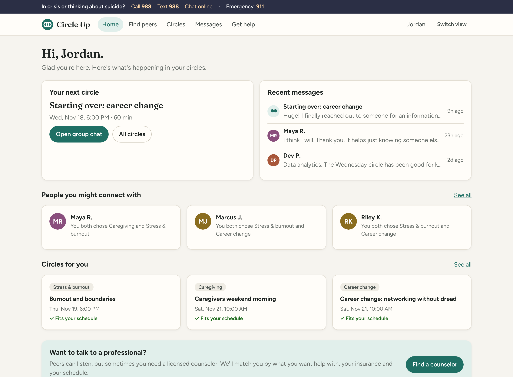
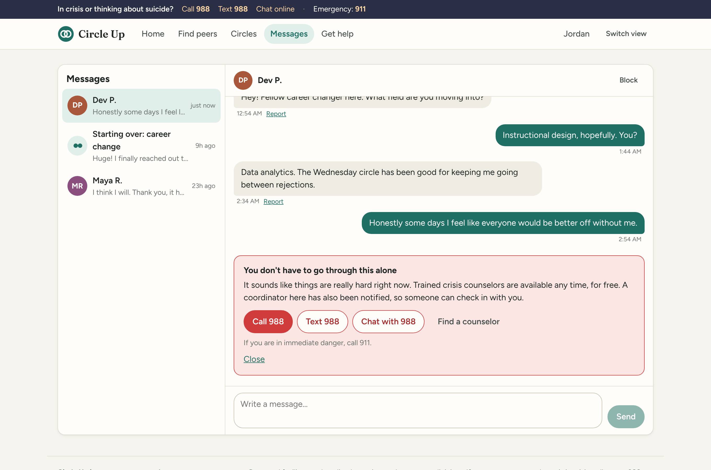
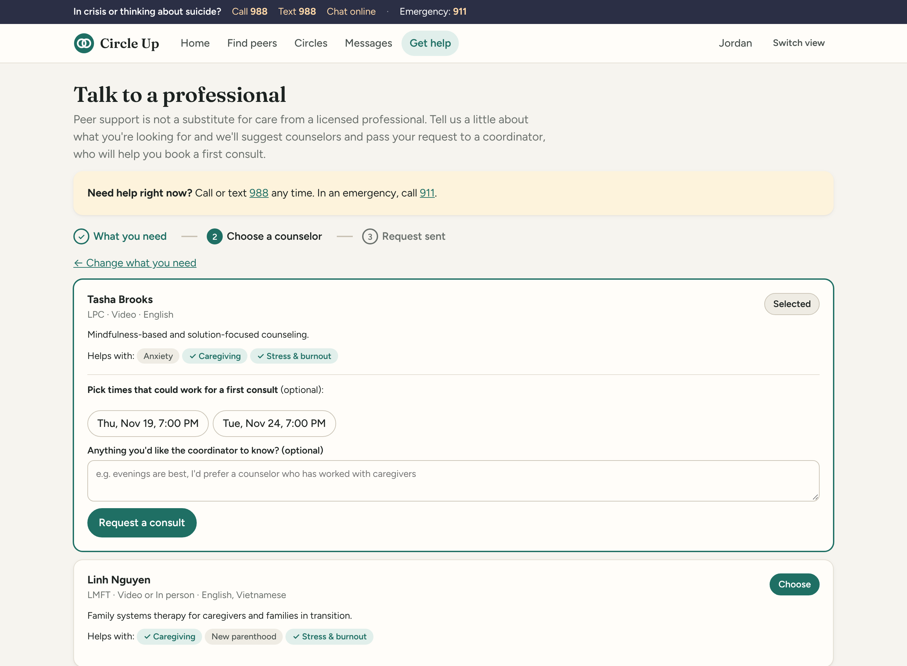
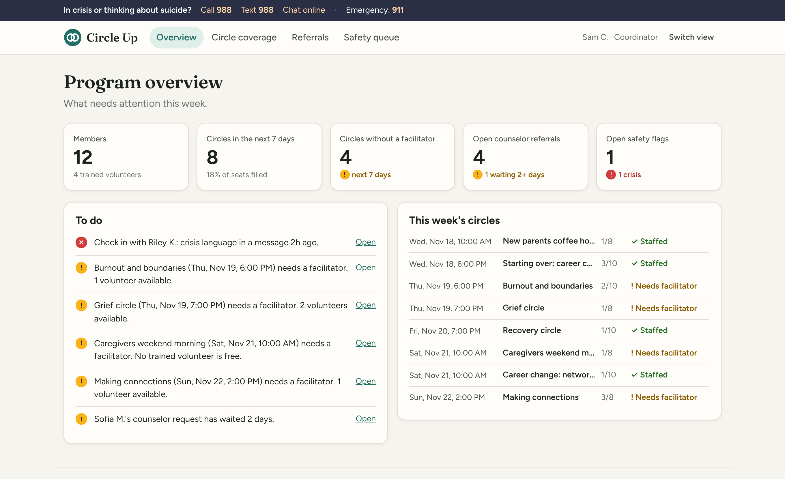
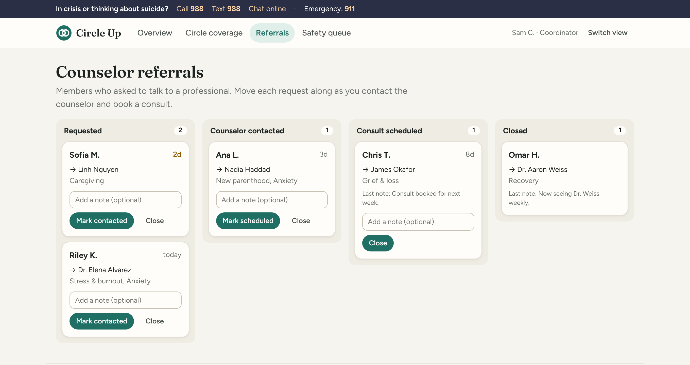
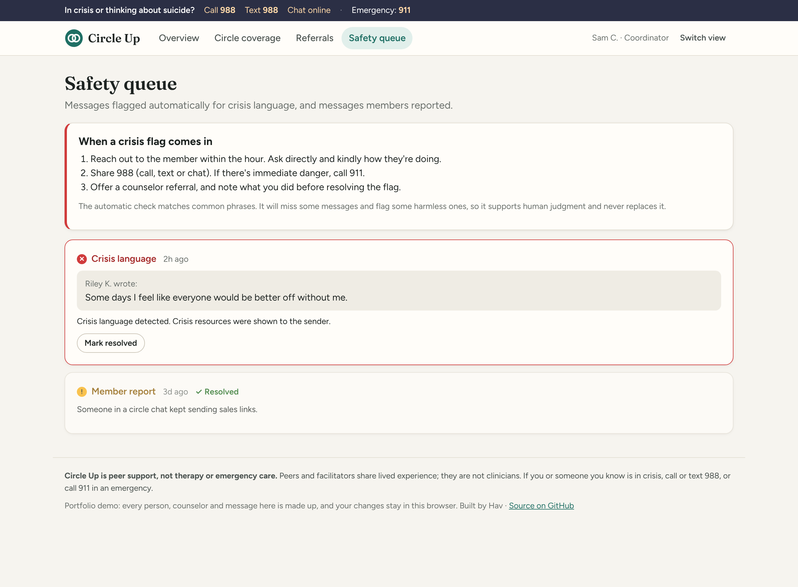
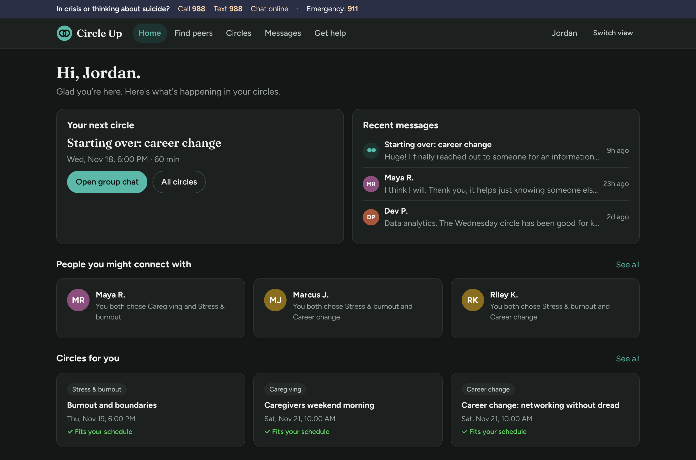

# Circle Up: Peer Support Platform

A full-stack web app that connects people going through similar experiences for peer support, and helps them reach a licensed counselor when they need more.

- **Peer matching.** Members choose the experiences they relate to (caregiving, grief, career change and others) and when they're free. The app ranks peers by what they share and explains each match.
- **Support circles.** Small group sessions led by trained volunteer facilitators. Members save a seat; coordinators see which sessions still need a facilitator and who is eligible to lead them.
- **Real-time chat.** One-on-one and circle group chat over WebSockets, with report and block.
- **Counselor referrals.** Members describe what they need, see matching counselors by specialty, insurance, language and format, and request a first consult. Coordinators track every request from *requested* to *scheduled*.
- **Safety by design.** Crisis resources (988, 911) are on every screen. Messages with crisis language immediately show the sender crisis resources and put the message in a coordinator's safety queue.

**[Live demo](https://havvie.github.io/circle-up/)** · Pick "member" or "coordinator". No sign-up. Every person, counselor and message is made up.



> **Circle Up is a portfolio project.** It is designed as peer support, not therapy or emergency care, and it is not a real service. If you or someone you know is in crisis, call or text **988** (US), or call **911** in an emergency.

## Why I built this

I spent 9+ years as a teacher, most recently running Early Intervention groups and coordinating support across families, specialists and staff. A lot of that job is logistics in service of people: getting the right person into the right group at the right time, noticing who needs more help, and handing off to a professional when that's what a situation calls for.

Peer support programs run on the same work. Circle Up is my take on the tool a small nonprofit or community program would need: a warm, simple experience for members, and a clear "what needs attention" view for the coordinator who keeps it all running.

## Screenshots

| Find peers | Support circles |
|---|---|
|  |  |

| Crisis response in chat | Counselor referral |
|---|---|
|  |  |

| Coordinator overview | Circle coverage |
|---|---|
|  |  |

| Referral pipeline | Safety queue |
|---|---|
|  |  |

| Phone | Dark mode |
|---|---|
|  |  |

## How it works

### Peer matching
Each candidate gets a score from 0 to 1:

- **60%** shared topics (Jaccard similarity: shared topics divided by all topics either person chose)
- **30%** shared free time (the share of your free slots the other person is also free in)
- **10%** a shared preferred format (one-on-one or group)

People with no topics in common, people either side has blocked, and people who opted out are never suggested. Each match lists plain-English reasons ("You both chose Caregiving and Stress & burnout", "Both free Tue evenings").

### Staffing circles
A volunteer can facilitate a circle only if they are trained on its topic, free at that time, and not already leading an overlapping circle. The coverage view lists only eligible volunteers, and flags circles where nobody is free so the coordinator can recruit or reschedule.

### Referrals
Counselors are filtered by insurance, language and format, then ranked by how many of the member's concerns they specialize in, then by soonest opening. A referral moves one step at a time (requested → counselor contacted → consult scheduled → closed), can be closed from any open step, and keeps a history of who moved it and why.

### Safety check
Messages are checked against common crisis phrases. When one matches, the sender sees 988 call, text and chat options and a link to find a counselor, the message is flagged for a coordinator, and the demo never sends an automated reply. The tests check both that crisis phrases are caught and that everyday phrases like "this deadline is killing me" are not.

Phrase matching is a basic safeguard. It will miss some messages and flag some harmless ones, which is why it routes to a person with a written protocol rather than acting on its own. A real deployment would also need trained moderators, clinical oversight, and a privacy review.

## Architecture

```
shared/        business rules used by BOTH the server and the browser demo
  service.js     every action (join a circle, send a message, move a referral…) with permission checks
  matching.js    peer scoring
  scheduling.js  circle recommendations and facilitator eligibility
  referrals.js   counselor matching and the referral state machine
  safety.js      crisis-language check and message validation
  memoryRepo.js  in-memory storage
  sampleData.js  made-up people, circles, counselors and messages
server/        Express API, MongoDB storage, Socket.io real-time chat, JWT auth
src/           React app (Vite)
  api/           demoApi (runs shared/service.js in the browser) and httpApi (talks to the server)
```

The business rules live in one place (`shared/service.js`) and talk to storage through a four-method interface (`find`, `get`, `insert`, `update`). The server plugs in MongoDB; the GitHub Pages demo and the fast tests plug in memory. So the live demo exercises the same rules the API enforces, without needing a hosted database.

**Tech:** React 18, Vite, Node.js, Express, MongoDB (official driver), Socket.io, JSON Web Tokens, bcrypt, Vitest, Supertest, GitHub Actions.

## Running it

**Front end only (same as the live demo):**

```bash
npm install
npm run dev
```

**Full stack (real server, logins and live chat):**

```bash
cd server
npm install
cp .env.example .env     # leave MONGO_URL out to use in-memory sample data
npm run dev              # API and chat on http://localhost:4000

# in another terminal, from the project root
VITE_API_URL=http://localhost:4000 npm run dev
```

Sample accounts (for example `jordan@example.com` and `sam@example.com`) use the password `circle-up-demo` locally. With `MONGO_URL` set, an empty database is seeded automatically; `npm run seed` resets it.

## Tests

```bash
npm test                 # shared logic: matching, scheduling, referrals, safety check
cd server && npm test    # API: auth, privacy, live chat delivery, crisis flags, referrals, permissions
```

The server tests run against in-memory storage locally and against a real MongoDB in GitHub Actions (`.github/workflows/server.yml`), so both storage backends are covered.

## Accessibility and privacy

- Status is always shown with an icon and words, never color alone; keyboard friendly; works on a phone; light and dark themes.
- Members see each other's display name, pronouns, short intro and topics, never email addresses. Conversations are visible only to their participants.
- The demo stores everything in your browser's local storage and sends nothing anywhere.

## Ideas for next steps

- Video rooms for circles, and calendar invites
- Facilitator check-ins after each session
- Email or SMS reminders
- Counselor-side portal to confirm consult times

## License

MIT
