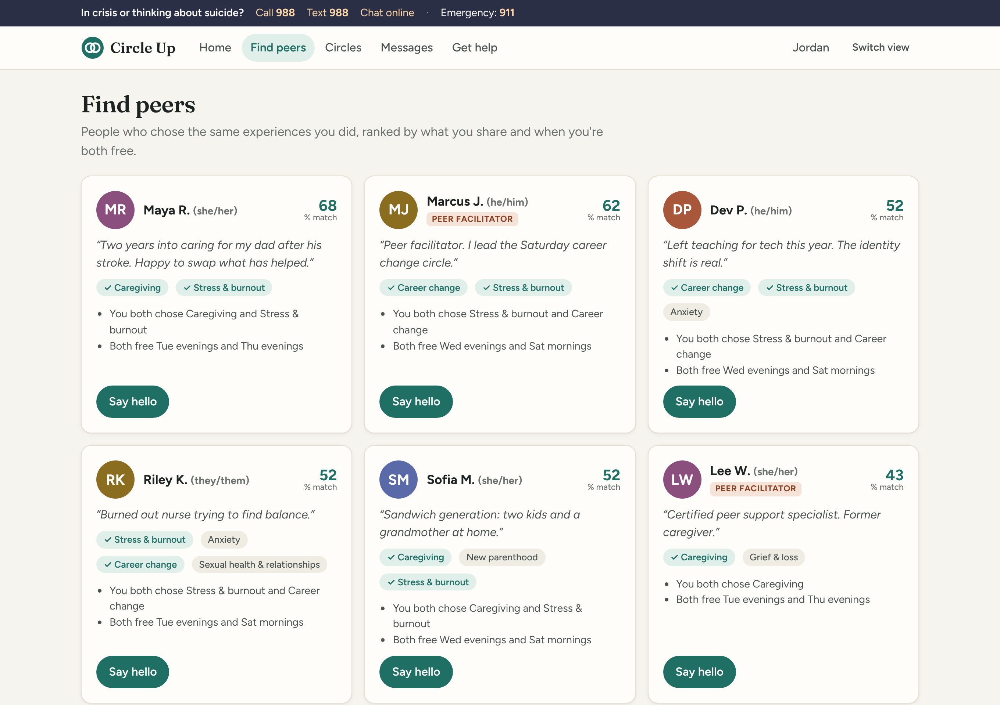
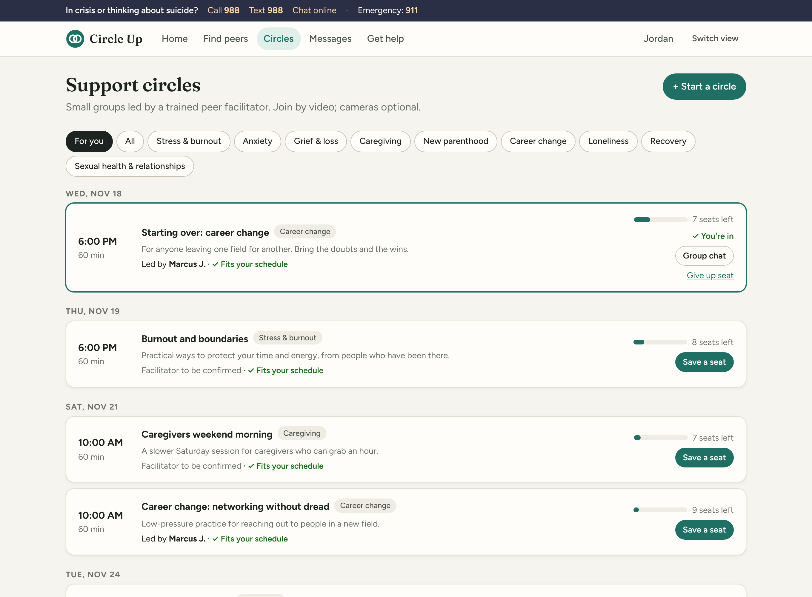
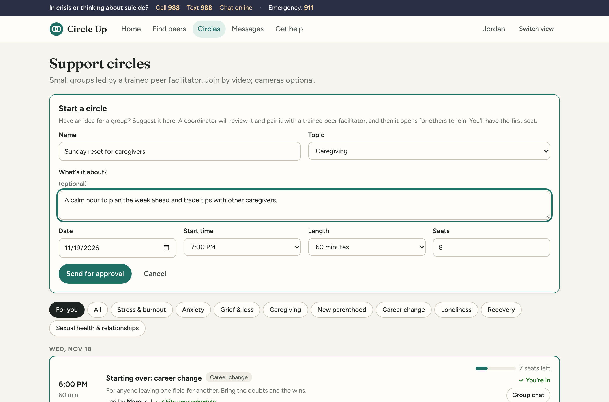
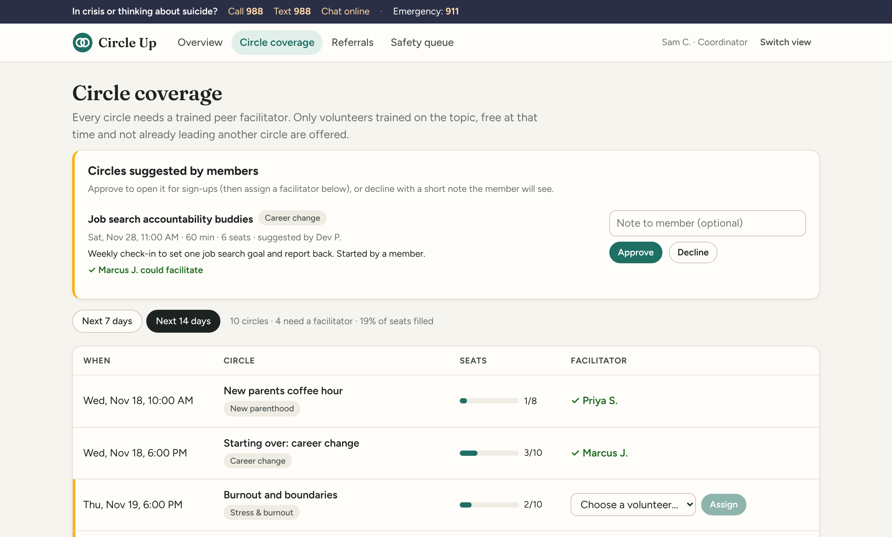
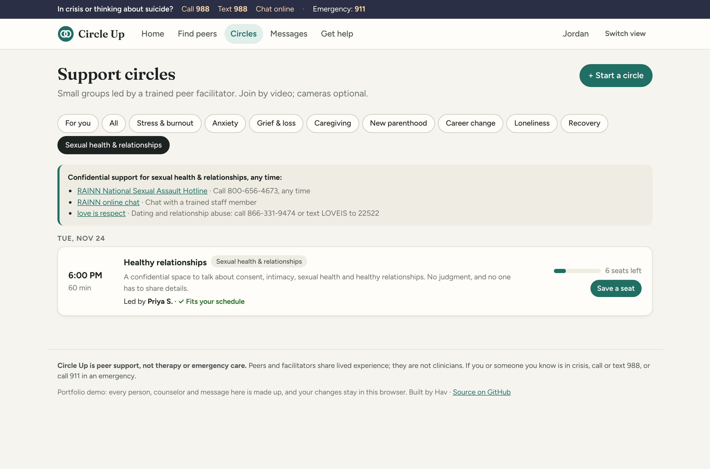
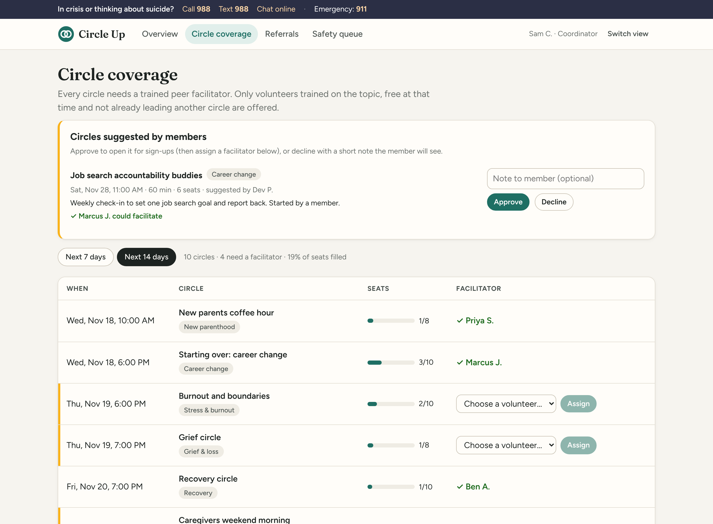
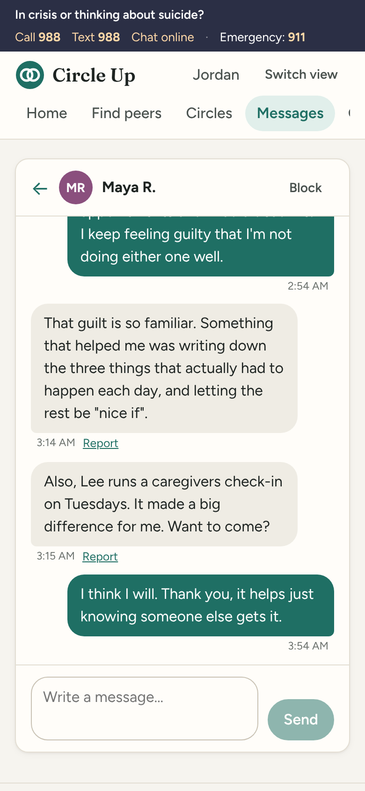

# Circle Up: A Place to Connect

*In a world full of uncertainty, Circle Up gives people a time and a place to connect with others who understand what they're going through.*

Circle Up is a full-stack web app that brings people together around shared life experiences, like caring for a parent, grieving a loss, changing careers, adjusting to new parenthood, navigating relationships and sexual health, or feeling isolated. Members find others who have been through something similar, talk one-on-one, and meet in small support circles led by trained volunteers. When someone needs more than a listening ear, the app helps them reach a licensed counselor.

**[Live demo](https://havvie.github.io/circle-up/)** · Choose "member" or "coordinator". No sign-up needed. Every person, counselor and message in the demo is made up.


- **Connect with people like you.** Pick the experiences you relate to and when you're free, and Circle Up suggests people you have the most in common with, along with the reasons why.
- **Show up together.** Save a seat in a small group circle that meets at a set time each week.
- **Start your own circle.** Suggest a new group with a topic, time and size. A coordinator approves it and pairs it with a trained facilitator.
- **Keep the conversation going.** Private one-on-one and group chat, live, with report and block built in.
- **Get more help when you need it.** Request a consult with a counselor who fits your needs, insurance and schedule.
- **Safe by design.** Crisis resources are on every screen, and topics like sexual health and recovery show their own confidential support lines (RAINN, love is respect, SAMHSA). Messages that suggest someone is in crisis are flagged so a coordinator can check in.

> **Circle Up is a portfolio project.** It is designed as peer support, not therapy or emergency care, and it is not a real service. If you or someone you know is in crisis, call or text **988** (US), or call **911** in an emergency.

## Why I built this

As a teacher, I've seen how much it helps when someone feels understood. A student who finally meets a classmate going through the same thing, or a parent who realizes other families are facing the same challenges, starts to feel less alone. That connection doesn't happen by accident. Someone has to create the time and the place for it.

Life feels uncertain for a lot of people right now, and many don't have a group of people who get it. I built Circle Up to make it easy to find them. The member side is designed to feel warm and simple. The coordinator side handles the behind-the-scenes work that keeps a support program running: staffing sessions, following up on counselor requests, and making sure no one in crisis goes unnoticed.

## Screenshots

| Find peers | Support circles |
|---|---|
|  |  |

| Start a circle | Approving a member's circle |
|---|---|
|  |  |

| Topic support lines |
|---|
|  |

| Crisis response in chat | Counselor referral |
|---|---|
|  |  |

| Coordinator overview | Circle coverage |
|---|---|
|  |  |

| Referral pipeline | Safety queue |
|---|---|
|  |  |

| Phone | Dark mode |
|---|---|
|  |  |

## How it works

### Peer matching
Each candidate gets a score from 0 to 1:

- **60%** shared topics (Jaccard similarity: shared topics divided by all topics either person chose)
- **30%** shared free time (the share of your free slots the other person is also free in)
- **10%** a shared preferred format (one-on-one or group)

People with no topics in common, people either side has blocked, and people who opted out are never suggested. Each match lists plain-English reasons ("You both chose Caregiving and Stress & burnout", "Both free Tue evenings").

### Member-created circles
Any member can suggest a circle: a name, topic, date and time (at least a day ahead), length and number of seats. It stays visible only to them until a coordinator approves it, and the coordinator sees right away which trained volunteers could facilitate at that time. Approved circles open for sign-ups; declined ones show the member the coordinator's note.

### Staffing circles
A volunteer can facilitate a circle only if they are trained on its topic, free at that time, and not already leading an overlapping circle. The coverage view lists only eligible volunteers, and flags circles where nobody is free so the coordinator can recruit or reschedule.

### Referrals
Counselors are filtered by insurance, language and format, then ranked by how many of the member's concerns they specialize in, then by soonest opening. A referral moves one step at a time (requested → counselor contacted → consult scheduled → closed), can be closed from any open step, and keeps a history of who moved it and why.

### Safety check
Messages are checked against common crisis phrases. When one matches, the sender sees 988 call, text and chat options and a link to find a counselor, the message is flagged for a coordinator, and the demo never sends an automated reply. The tests check both that crisis phrases are caught and that everyday phrases like "this deadline is killing me" are not.

Phrase matching is a basic safeguard. It will miss some messages and flag some harmless ones, which is why it routes to a person with a written protocol rather than acting on its own. A real deployment would also need trained moderators, clinical oversight, and a privacy review.

## Architecture

```
shared/        business rules used by BOTH the server and the browser demo
  service.js     every action (join a circle, send a message, move a referral…) with permission checks
  matching.js    peer scoring
  scheduling.js  circle recommendations and facilitator eligibility
  referrals.js   counselor matching and the referral state machine
  safety.js      crisis-language check and message validation
  memoryRepo.js  in-memory storage
  sampleData.js  made-up people, circles, counselors and messages
server/        Express API, MongoDB storage, Socket.io real-time chat, JWT auth
src/           React app (Vite)
  api/           demoApi (runs shared/service.js in the browser) and httpApi (talks to the server)
```

The business rules live in one place (`shared/service.js`) and talk to storage through a four-method interface (`find`, `get`, `insert`, `update`). The server plugs in MongoDB; the GitHub Pages demo and the fast tests plug in memory. So the live demo exercises the same rules the API enforces, without needing a hosted database.

**Tech:** React 18, Vite, Node.js, Express, MongoDB (official driver), Socket.io, JSON Web Tokens, bcrypt, Vitest, Supertest, GitHub Actions.

## Running it

**Front end only (same as the live demo):**

```bash
npm install
npm run dev
```

**Full stack (real server, logins and live chat):**

```bash
cd server
npm install
cp .env.example .env     # leave MONGO_URL out to use in-memory sample data
npm run dev              # API and chat on http://localhost:4000

# in another terminal, from the project root
VITE_API_URL=http://localhost:4000 npm run dev
```

Sample accounts (for example `jordan@example.com` and `sam@example.com`) use the password `circle-up-demo` locally. With `MONGO_URL` set, an empty database is seeded automatically; `npm run seed` resets it.

## Tests

```bash
npm test                 # shared logic: matching, scheduling, referrals, safety check
cd server && npm test    # API: auth, privacy, live chat delivery, crisis flags, referrals, permissions
```

The server tests run against in-memory storage locally and against a real MongoDB in GitHub Actions (`.github/workflows/server.yml`), so both storage backends are covered.

## Accessibility and privacy

- Status is always shown with an icon and words, never color alone; keyboard friendly; works on a phone; light and dark themes.
- Members see each other's display name, pronouns, short intro and topics, never email addresses. Conversations are visible only to their participants.
- The demo stores everything in your browser's local storage and sends nothing anywhere.

## Ideas for next steps

- Video rooms for circles, and calendar invites
- Facilitator check-ins after each session
- Email or SMS reminders
- Counselor-side portal to confirm consult times

## License

MIT
